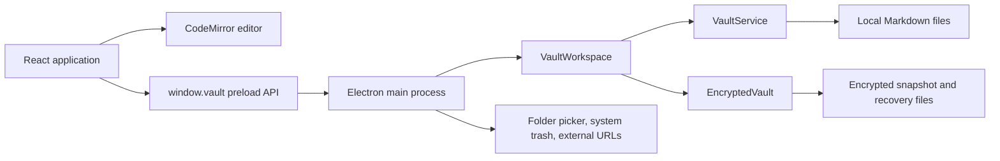

# Obsidian clone specification

## 1. Document scope and baseline

This document specifies the current implementation of the `obsidian-clone` repository, whose application name is **Black Cobble**. It covers product behavior, interface states, editor rules, process boundaries, persistence, encryption, recovery, build tooling, and verification. It is a specification of the checked-out application, not a promise of full Obsidian compatibility.

| Baseline | Value |
| --- | --- |
| Review date | 6 October 2026 |
| Repository | `C:/Users/grigo/Documents/ChatGPT/obsidian-clone` |
| Branch reviewed | `master` |
| Commit reviewed | `f3d54f4cd8ce3e1b06c064b1e40aa22c4add9338` |
| Commit subject | `encryption two vaults` |
| Package name and version | `black-cobble`, `0.1.1` |
| Product and window name | `Black Cobble` |
| Electron application ID | `local.blackcobble.editor` |
| Initial tracked-file state | Clean |
| Inventory | 52 tracked files, including 10 unit-test files and 5 Electron workflow-test files |

Statements about implemented behavior derive from source and tests. Explicit limitations describe what the implementation does not guarantee. Acceptance criteria describe observable behavior already supported by the application. They do not imply that every criterion has an individual automated test.

The README calls the product `alfa-0.1` while the package version is `0.1.1`. `PLAN.md` contains older release names and test counts. The current manifest and validation results in section 17 take precedence for this baseline. Historical agent allocations in planning documents are development history, not application requirements.

### Contents

- [Product scope](#2-product-scope)
- [Architecture and ownership](#3-architecture-and-ownership)
- [Workspace lifecycle](#4-workspace-lifecycle)
- [Interface specification](#5-interface-specification)
- [Files, folders, and dragging](#6-files-folders-and-dragging)
- [Markdown editor](#7-markdown-editor)
- [HTML notes](#7a-html-notes)
- [Links and navigation](#8-links-and-navigation)
- [Save, refresh, and conflict behavior](#9-save-refresh-and-conflict-behavior)
- [Private sessions and recovery](#10-private-sessions-and-recovery)
- [Persistence and data formats](#11-persistence-and-data-formats)
- [IPC contract](#12-ipc-contract)
- [Security boundaries and limits](#13-security-boundaries-and-limits)
- [Legacy encryption compatibility](#14-legacy-encryption-compatibility)
- [Build and distribution](#15-build-and-distribution)
- [Acceptance criteria](#16-acceptance-criteria)
- [Verification and test inventory](#17-verification-and-test-inventory)
- [Known limitations and gaps](#18-known-limitations-and-gaps)
- [Repository coverage](#19-repository-coverage)

## 2. Product scope

Black Cobble is a desktop editor for local Markdown notes. A user opens one folder as a workspace and works in either its normal vault or its separate private vault. The application displays one note at a time in one main window.

The normal vault consists of actual folders and UTF-8 `.md` files. Other editors can read and modify these files. The private vault is a virtual filesystem stored as encrypted snapshots inside `.black-cobble-private` at the normal vault root. Its note names and folders are not actual filesystem entries.

The interface is Spanish. Dark mode is the initial theme, with a remembered light-mode option. The core workflow is opening a folder, creating or selecting a note, editing Markdown, navigating links, and saving locally.

### Implemented capabilities

| Area | Supported behavior |
| --- | --- |
| Workspaces | Native folder picker, create-folder option, restore last workspace |
| Tree | Nested folders, sorting, expansion, filename filtering, selected and active entries |
| Management | Create notes and folders, rename, move, drag to folders or root, delete with confirmation |
| Editing | CodeMirror 6, live Markdown decorations, source mode, wrapping, undo/redo, tasks |
| Navigation | Wikilinks, aliases, headings, path completion, missing-target creation, Markdown links |
| Saving | 450 ms autosave, immediate save shortcut, save before ordinary navigation and mutations |
| External changes | File watching, clean-note reload, conflict detection, save-copy and discard actions |
| Privacy | Whole-vault encryption, password setup/unlock/change, manual and inactivity locking |
| Recovery | Encrypted drafts, lock-time draft commits, encrypted conflict recovery files |
| Delivery | Local development, production build, Windows portable packaging, packaged-app smoke test |

### Excluded product functions

There is no account system, cloud synchronization, collaboration service, graph view, backlinks panel, canvas, plugin loader, command palette, tabs, split editors, or general attachment manager. There is no settings screen beyond the controls described here. Normal and private notes do not resolve links across vaults. There is no automatic import/export workflow, backup scheduler, password recovery, or automatic migration of the old per-note encryption format.

Sources: [package manifest](package.json), [application](src/App.tsx), [workspace router](electron/vault-workspace.ts), [README](README.md), [MVP plan](PLAN.md).

## 3. Architecture and ownership

### Process map



| Module | Owner and responsibilities |
| --- | --- |
| `src/main.tsx` | Mounts React under `StrictMode` and loads global styling |
| `src/App.tsx` | Coordinates selected vault, tree, active note, save state, dialogs, conflicts, preferences, and private-session invalidation |
| `src/editor/MarkdownEditor.tsx` | Owns a CodeMirror view, completion, link clicks, heading focus, and editor cleanup |
| `src/editor/livePreview.ts` | Builds Markdown decorations and safe widgets without changing stored text |
| `src/editor/wikilinks.ts` | Parses link parts, chooses visible label ranges, and resolves against known note paths |
| `electron/preload.ts` | Exposes a fixed API and event subscriptions through context isolation; buffers early close requests and reports trusted input |
| `electron/main.ts` | Owns the window, workspace replacement, IPC authorization, system integrations, inactivity deadline, and final close decision |
| `electron/vault-workspace.ts` | Routes operations to the selected vault and blocks hidden/internal paths and obsolete conversion operations |
| `electron/storage.ts` | Owns normal filesystem operations, SHA-256 versions, watchers, link-preserving moves, and retained legacy per-note storage code |
| `electron/encrypted-vault.ts` | Owns encrypted virtual-tree state, session keys, full-snapshot writes, private drafts, and recovery |
| `electron/crypto.ts` | Implements strict encryption formats, authenticated envelopes, and password wrapping |
| `electron/session-timer.ts` | Tracks private-session inactivity independently from background save activity |
| `shared/types.ts` | Defines renderer/main data and API types |
| `shared/linkUpdates.ts` | Rewrites wikilinks when a rename or move would otherwise change their resolved destination |

There is no server or database. Electron main is the only application process that accesses note files or holds the private vault key. An unlocked private note's text is also present in the renderer for editing. The renderer has no direct Node.js or general filesystem API.

### State and asynchronous ownership

`App` keeps React state and matching refs for operations that must use current state after an `await`. `ActiveNote` extends `NoteDocument` with `savedContent`, `conflict`, and optional `missing`. Dirty state is `content !== savedContent`.

Renderer request captures include a generation, active vault path, and private session ID. Results from replaced vaults or revoked sessions are ignored. Refreshes also use a monotonically increasing refresh ID. A revoked-session set prevents a delayed unlock notification from reinstating an old session.

Main uses `privateEpoch`, workspace identity, active vault path, session tokens, and closing/changing flags to check asynchronous results. Storage operations serialize through promise queues that remain usable after rejection. Private draft admission deliberately seals state before entering the queue, so immediate locking can preserve an already accepted edit.

Sources: [application state](src/App.tsx), [main-process guards](electron/main.ts), [normal storage queue](electron/storage.ts), [private queue and drafts](electron/encrypted-vault.ts).

## 4. Workspace lifecycle

### Startup

1. Main optionally accepts `BOVEDA_USER_DATA`, requiring an absolute path.
2. It temporarily uses the old application name `Bóveda` to retain the alpha profile path, then sets the current name `Black Cobble` and enables sandboxing.
3. After Electron becomes ready, main registers IPC handlers and restores a workspace.
4. `BOVEDA_TEST_VAULT`, when set, selects an absolute test workspace without updating last-vault settings. Otherwise main reads `settings.json` under Electron user data.
5. Missing, malformed, inaccessible, or stale last-vault settings return the user to the opening screen rather than preventing startup.
6. Main creates the window and loads either the production renderer or an allowed local development URL.
7. React subscribes to private-session changes before asynchronous initialization, obtains vault/session/tree state, and restores the last existing normal note.

`VaultWorkspace.initialize()` initializes normal storage and the encrypted child. The workspace begins in normal mode. Private mode and its session are not restored as unlocked at startup.

Opening `.black-cobble-private` itself is rejected. A folder containing `vault.sealed` at its own root is also rejected with an instruction to open the parent. The workspace root must resolve to a real directory.

### Folder selection and replacement

The picker offers `openDirectory` and `createDirectory`, starts at the current vault or Documents, and returns `null` on cancellation. Main shares concurrent open requests through one `opening` promise.

Ordinary UI workspace replacement first flushes the current editable note. Main locks the previous private session and handles any sealed state that exists only in memory. It initializes the new workspace, saves its normal root to settings, installs it as the current workspace, disposes the previous one, and publishes tree/session changes. A failed initialization disposes the candidate and leaves the previous workspace object available. Its private session may already be locked.

### Vault-mode switching

- Selecting `Privada` clears normal renderer content and displays either password setup, a locked view, or the unlocked private tree.
- Selecting `Normal` first saves through the renderer's action flow, then main locks private storage and resolves memory-only changes before completing the switch.
- Normal and private modes share the same workspace parent, theme, and window, but use independent trees and note paths.
- Returning to normal may restore its remembered note. Private unlock does not restore a remembered private note or expanded tree.

### Close, crash, and window recreation

Native close is intercepted until main has completed the close handshake. Main immediately revokes the private session and sends `vault:before-close` once the renderer is ready. Preload buffers a close request that arrives before React subscribes.

The renderer waits for current UI work, flushes pending normal edits, and sends `vault:confirm-close` only after successful save. Failed saves or unresolved conflicts leave the window open. Main then locks again, resolves memory-only private changes, sets `confirmedClose`, and closes the window.

A renderer crash locks the private session. A pending close can finish without a crashed renderer's acknowledgement, but renderer-only edits cannot be reconstructed. Starting a main-frame navigation also locks. A missed private lock acknowledgement causes main to destroy and recreate the renderer after two seconds.

On macOS, closing every window does not quit automatically, and activation can create a window again. On other platforms, closing all windows quits unless main is replacing a renderer. No single-instance lock or cross-process workspace coordination is implemented.

Sources: `selectVault`, `restoreVault`, `createWindow`, `finishClose`, and `publishSession` in [main](electron/main.ts); [preload close buffering](electron/preload.ts); `runAction` and close subscriptions in [App](src/App.tsx).

## 5. Interface specification

### Layout

The initial window is 1280 by 850 pixels, with a minimum size of 760 by 520. It has a native frame, no application menu, and a hidden-until-ready initial window. The initial background is dark.

When a vault is open, the interface has a fixed-width sidebar and a flexible main pane. The sidebar is 255 pixels wide, with a 210-pixel minimum. CSS contains narrower-screen adjustments, although the native minimum width is larger than the main 720-pixel breakpoint. The sidebar is hideable, not resizable.

The sidebar contains the vault name/root selection, hide control, `Normal` and `Privada` selector, creation controls, selected-entry action menu, filename search, scrollable tree, optional private lock/password controls, change-vault action, and theme switch. Private creation/search controls disappear while locked.

The main pane contains a note path toolbar, preview/source toggle when a note is open, optional private indicator and lock control, alert/recovery rows when needed, the editor or an empty state, and save/word-count status. Hiding the sidebar exposes a show-files button in the toolbar.

### States

| State | Display and permitted next steps |
| --- | --- |
| Loading | `Abriendo bóveda…`; initialization is busy |
| No workspace | Product name, short local-note description, folder-opening action, theme switch |
| Empty tree | `La bóveda está vacía.`; creation remains available when unlocked |
| No selected note | `Abre una nota o crea una nueva.` and a new-note action |
| Normal note open | Editable note, path, preview toggle, save status, word count |
| Private unconfigured | `Crea tu bóveda privada` and `Crear contraseña`, unless a storage/legacy error blocks setup |
| Private locked | `Bóveda privada bloqueada` and `Desbloquear bóveda`; no private tree, search, or editor |
| Private unlocked | Virtual tree and same editing workflow, with lock and change-password controls |
| Save failure | Error alert with retry action when relevant |
| Conflict | Retained local text, save-copy action, discard-and-reload or discard-and-close action |
| Recovery available | Pending encrypted-draft paths with recover-copy and confirmed-discard actions |

Entry operations and password actions use native HTML modal dialogs. Entry-dialog Escape/cancel is blocked while its operation is busy. Naming dialogs focus/select the initial name. Move uses a destination-folder select with an explicit root option. Delete dialogs distinguish system trash from permanent private deletion.

The file menu opens from the three-dot control or a right click on an entry. Clicking the dismissal layer closes it. Right click changes the selected entry without opening that note. The active editor note and selected tree entry are separate state.

### Search and persistence

Search trims and lowercases the query and matches entry **names**, including the underlying `.md` extension. A folder remains visible when it or a descendant matches. Search forces matching folders open for display without changing the stored expansion set. It does not index note bodies or provide ranked results. A folder-name match does not automatically make every nonmatching child visible.

Theme is global. Expanded folders and the last-opened note are stored only for normal vaults. Search, selected folder, sidebar visibility, source mode, heading focus, and private mode are not saved as preferences. Private lock clears sensitive state and resets source mode.

Word count trims note text and counts whitespace-separated tokens. It includes Markdown syntax and is not a language-aware count.

### Accessibility and styling

Controls use accessible names and native buttons, inputs, selects, and dialogs. Alerts have `role="alert"`; save status has `aria-live="polite"`. Busy navigation/editor areas use `inert`, and the editor wrapper has `aria-busy`. Task widgets have Spanish checked/unchecked labels. Focus-visible outlines use the accent color.

The tree is a nested list of buttons, not an ARIA tree widget with a dedicated arrow-key navigation model. Dragging has a move-dialog alternative. The code does not demonstrate a full keyboard or screen-reader accessibility audit.

Colors use CSS variables for dark/light backgrounds, text, borders, muted text, danger, and a purple accent. Text and paths truncate in navigation. The editor hides gutters, wraps lines, centers content, and uses a monospace font in source mode. There is no font chooser, zoom setting, or theme plugin system.

Sources: [App rendering](src/App.tsx), [FileTree](src/components/FileTree.tsx), [entry dialog](src/components/EntryDialog.tsx), [password dialog](src/components/PrivatePasswordDialog.tsx), [application CSS](src/styles.css), [editor CSS](src/editor/editor.css).

## 6. Files, folders, and dragging

### Enumeration and paths

Trees list folders first, then files. Within each group, names sort with Spanish locale, numeric ordering, and base sensitivity. Normal enumeration recursively includes `.md` files with a case-insensitive extension. It omits dot-prefixed entries, symbolic links, and non-Markdown files. Folders remain visible even when empty. Hidden `.obsidian` configuration is not read or modified by application note operations.

API paths are vault-relative strings with forward slashes. The empty string denotes the root for parent/destination arguments. Note contents are not addressed by absolute paths. Workspace routing rejects dot-prefixed path components, including attempts to reach private storage.

New names are trimmed, reject empty and hidden names, path separators, Windows-invalid punctuation/control characters, trailing dots, and Windows reserved device names. Note creation/rename appends `.md` unless already present case-insensitively. The completed filename must fit in 240 UTF-8 bytes. Folder names may contain dots when the name does not start or end with one.

Normal storage verifies every existing path component with `lstat` and `realpath`, rejects symbolic links even if they lead back inside the vault, and checks the root has not been replaced. Private paths additionally reject trailing spaces/dots in components and compare collisions case-insensitively. Normal collisions follow filesystem behavior, with an explicit Windows case-only rename allowance.

### Creation and selection

The selected folder is the creation parent. Selecting a file makes its parent the creation parent. Selecting the vault name selects root without closing the current editor note. A new folder becomes selected and expanded. A new note is an empty document, becomes active, expands its ancestor folders, and records its path only in normal preferences.

Creating a missing link target can create several missing folders, then the empty note. This multi-step normal workflow is not one transaction; an error can leave successfully created folders behind. The missing-target dialog confirms the calculated path rather than asking for another name.

### Rename and move

Both flows save pending edits first. A note rename preserves its extension rule; a folder rename changes descendants' paths. Moves require an existing destination folder, reject collisions, and prevent moving a folder into itself or a descendant. A same-path operation is a storage no-op where supported.

After a successful move/rename, the renderer updates active-note and selected paths, remaps expanded folders, expands destination ancestors, updates normal last-note preferences, and rereads the open note. The reread includes any rewritten content and new version before editing resumes, even if another note was the renamed link target.

Normal relocation scans all visible Markdown notes, not just descendants of the moved entry. It prepares original bytes/versions and required link rewrites, rechecks the full note-path set and versions before moving, renames the entry, and writes changed note bodies. For directory moves, it releases watchers first and reinstalls them even after failure.

If a rewrite fails, normal storage restores previously written notes only when their current version still matches this operation's output. It moves the entry back only if restoration succeeded and paths permit it. If rollback cannot safely complete, it retains intervening external edits and reports the incomplete destination and affected paths. This is a recoverable sequence of filesystem operations, not an atomic multi-file transaction.

Private relocation changes the virtual tree and rewrites notes/drafts in one new encrypted snapshot. It also updates a draft's expected version when the draft was based on the note's prior current version.

### Delete

Normal deletion sends the actual file or entire selected directory to Electron's system trash integration. Directory watchers are released and restored around the operation. A folder deletion includes filesystem contents omitted from the displayed tree; the same applies to normal directory moves and renames.

Private deletion requires UI confirmation and removes the note/folder subtree and matching drafts from the snapshot. It never exports decrypted files to system trash. There is no application undelete for private notes. This is logical removal from current state, not secure erasure of old backups or filesystem history.

### Internal drag-and-drop

Dragging uses `application/x-boveda-entry` with `{ path, token }`, where the token is a new renderer UUID for that drag. Only payloads matching the currently active internal drag are accepted. OS `Files` drops are rejected; this is not an import function.

Valid targets are other folders, the vault header, and empty tree space for root. Files are not destinations. Same-parent drops, unknown sources/destinations, and self/descendant folder drops are rejected. Name collisions are enforced by storage after the UI's destination checks.

The target gets a visible highlight. Hovering an eligible collapsed folder opens it after 600 ms. Busy state and unresolved conflicts prevent dragging. Drop clears drag state, flushes edits, rereads the tree, revalidates the destination, moves, and refreshes again.

Sources: [normal CRUD and relocation](electron/storage.ts), [private CRUD](electron/encrypted-vault.ts), [drag validation](src/lib/treeDnd.ts), [path helpers](src/lib/paths.ts), [App management flows](src/App.tsx).

## 7. Markdown editor

### Editing model

The editor maintains Markdown text as its source of truth. Preview is a CodeMirror decoration field applied to that same document; it does not serialize HTML back to Markdown. No separate rendered-reading pane exists.

Every line touched by the current selection exposes its syntax. Other lines can hide formatting markers and show widgets. Source mode clears preview decorations while retaining Markdown syntax highlighting and normal editing. Changing preview or theme reconfigures editor compartments.

CodeMirror enables history, drawn selections, drop cursor, active-line support, indentation on input, Markdown/GFM parsing, line wrapping, spellcheck, completion, default/history/Markdown keymaps, and Tab indentation. App-level Ctrl/Cmd+S saves immediately; Ctrl/Cmd+N opens note creation. Standard editor undo/redo comes from CodeMirror rather than custom toolbar buttons.

The editor is keyed by vault path, note path, and private session identity. A different note/session gets a new view and history. Cleanup closes completion, replaces the old editor state with an empty document/history/note list, disables old callbacks, and destroys the view. This prevents delayed completion callbacks from retaining a live sensitive editor or producing errors after navigation.

External value updates replace the current document without adding a new undo-history item. The implementation does not promise secure elimination of previous JavaScript strings or all historical copies.

### Preview support

| Markdown form | Behavior |
| --- | --- |
| ATX and setext headings | Heading styling; markers hidden off selected lines |
| Strong/emphasis/strikethrough | Text styling and inactive-marker hiding |
| Blockquotes | Quote-line border/style; inactive quote markers hidden |
| Unordered lists | Inactive single-character list marks become bullet widgets |
| Ordered lists | Markdown parsing/styling; numbers remain text |
| Tasks | Inactive `[ ]`/`[x]` markers become checkbox widgets |
| Inline code | Monospace background; inactive backticks hidden |
| Fenced and indented code | Code-line styling; inactive fence text hidden where recognized |
| Horizontal rules | Inactive rule syntax becomes a separator widget |
| GFM tables | Basic row/cell/header styling; textual separators remain |
| Inline Markdown links and angle autolinks | Link marks, hidden inactive delimiters, navigation targets |
| Wikilinks | Resolved/unresolved styling, full target metadata, shortened inactive labels |
| Supported images | Safe remote or embedded raster-image widget, with private-mode restrictions |

Task changes locate the widget's current line through CodeMirror rather than retaining a stale position. The widget changes the single checkbox character and lets the ordinary save flow persist it.

Code regions and escaped wiki brackets remain literal and do not become navigable wikilinks. Preview requests syntax parsing with bounded time budgets and skips wiki matches beyond the available tree. The large-note code-region regression test verifies the parser continues beyond its initial budget in the tested case; this is not a performance guarantee for every note size.

### Images and HTML

Image widgets accept `https:` URLs and base64 `data:image` sources limited to PNG, JPEG, GIF, and WebP. They reject `http:` URLs (the CSP only allows HTTPS images), local files, relative attachment paths, `javascript:` sources, and SVG data images; rejected sources render as an accessible placeholder that names the reason and keeps the alt text. Recognized inline syntax supports alt text and an optional quoted title. Images load lazily, request editor measurement on load/error, and are constrained to the editor width and a 420-pixel maximum height.

In normal notes, remote images can make network requests automatically when previewed. In private notes, HTTPS image syntax becomes an explicit clickable external link rather than an image request; HTTP images keep the rejected-source placeholder. Embedded allowed data images can still display privately.

In Markdown notes raw HTML remains text; preview does not evaluate HTML or scripts. HTML notes are covered in section 7A. There is no HTML renderer, local-attachment loader, PDF/media embed, note transclusion, formula renderer, or Mermaid renderer.

Sources: [MarkdownEditor](src/editor/MarkdownEditor.tsx), [live preview](src/editor/livePreview.ts), [editor CSS](src/editor/editor.css), [editor preview tests](tests/editor-preview.test.ts), [completion tests](tests/editor-completion.test.ts).

## 7A. HTML notes

Notes can be Markdown (`.md`) or HTML (`.html`). The format comes from the extension and never changes: renaming keeps it and rejects a name with the other extension. Markdown stays the default and the only Obsidian-compatible format. Obsidian ignores HTML notes as notes; links to them from Markdown keep the `.html` extension so Obsidian still resolves them as files.

### Files and naming

`shared/notes.ts` owns formats, extensions and the new-note template. A folder may not hold `Nota.md` and `Nota.html` together, in either vault: creation, rename, move and private copies reject the second name with "Ya existe una nota con ese nombre en otro formato." Existing vaults with both files still open; bare links then resolve to Markdown first.

New HTML notes start as a full document with `<!doctype html>`, `lang="es"`, UTF-8 charset, `<meta name="generator" content="Black Cobble">`, an escaped `<title>` and an empty paragraph. The private vault accepts both extensions in its snapshot validator; earlier snapshots stay valid. An earlier build reports a private vault containing HTML notes as damaged.

### Editing model

The visual editor is TipTap 3 (ProseMirror) and owns only the `<body>` contents. Everything before `<body …>` and from `</body>` on is kept byte for byte. A file without a body element is treated as a fragment. Serialized output places one block per line (`formatHtmlBlocks`) for readable, deterministic diffs; only whitespace between block elements is added.

Opening a note never writes it. Schema normalization that arrives without an edit is ignored, and returning to the loaded content restores the original bytes. The first real edit reserializes the body through the schema, so unsupported markup, attributes and inline styles in the body are dropped at that point. Source mode shows the whole file in CodeMirror with HTML highlighting and edits it without normalization.

Supported content: paragraphs, headings 1–6, bold, italic, strike, underline, inline code, links, bullet/ordered/task lists (nested), blockquotes, code blocks, horizontal rules, tables with header rows and images. A toolbar covers marks, headings 1–3, lists, quote, code block, separator, table insertion and row/column editing, and undo/redo. Markdown-style input rules (`# `, `**x**`, `- `, `[ ] `, `> `, ``` ``` ```) also work.

### Wikilinks in HTML

Wikilinks are stored as `<a class="wikilink" data-wikilink="Ruta#Encabezado">alias</a>`; the link text is the alias. Typing `[[` opens note completion; typing a complete `[[Ruta#H|alias]]` converts it. Unresolved targets are styled dashed. A click opens the target, offers to create a missing note or follows external `http(s)`/`mailto` links through the main process.

Resolution is shared with Markdown: bare names try `.md`, then `.html`. Moving or renaming rewrites `data-wikilink` attributes with parse5 source offsets, changing nothing else in the file. Links inside text, comments or code are not elements and are never rewritten. A link created from an HTML note to a missing bare name creates an HTML note.

### Security

HTML notes are untrusted input. The body is parsed into the editor schema, which keeps only known nodes, marks and attributes: scripts, styles, event handlers, forms, frames and objects never reach the DOM, and `javascript:` links are dropped. Parsing uses an inert document, so nothing runs or loads during parsing. Images render through a node view that applies the Markdown image policy (HTTPS or PNG/JPEG/GIF/WebP data; HTTP and other sources show an accessible placeholder; remote images blocked in the private vault) without changing the saved `src`. Word counts parse the body with an inert `DOMParser`. The CSP adds `form-action 'none'` and `frame-src 'none'`.

Sources: [formats](shared/notes.ts), [HTML editor](src/editor/HtmlEditor.tsx), [HTML wikilinks](src/editor/htmlWikiLinks.ts), [document helpers](src/editor/htmlDocument.ts), [link rewriting](shared/linkUpdates.ts), [unit tests](tests/html-notes.test.ts), [desktop tests](tests/e2e/html-notes.spec.ts).

## 8. Links and navigation

### Wikilink syntax and labels

Supported parts are `[[path#heading|alias]]`, with heading and alias optional. The parser splits on the first pipe, then the first hash in the destination, and trims each part. `.md` is optional for resolution. Backslashes in link paths normalize to forward slashes, although storage paths themselves must use forward slashes.

Inactive labels prefer a nonempty alias. Otherwise they show the final path component without `.md`, or the heading text for heading-only links. An empty alias falls back to the basename. Full syntax reappears on a selected line or in source mode. The stored Markdown and full navigation target are preserved.

Examples:

| Stored text | Inactive label |
| --- | --- |
| `[[programacion/js]]` | `js` |
| `[[programacion/js.md#Funciones]]` | `js` |
| `[[programacion/js|JavaScript]]` | `JavaScript` |
| `[[programacion/js| ]]` | `js` |
| `[[#Detalles]]` | `Detalles` |

### Resolution order

Resolution uses only note paths in the currently active tree. Comparison is case-insensitive, and returned paths retain their original case.

1. A heading-only link refers to the current note.
2. An explicit `./` or `../` path resolves from the current note's folder. Traversal above root fails.
3. A bare name tries a sibling note first.
4. It then tries the normalized root path.
5. A path containing a slash can next try that path under the current folder.
6. A bare name with no earlier match uses a deterministic basename fallback from sorted note paths.

There is no ambiguity dialog. For example, `[[Plan]]` in `trabajo/Actual.md` favors `trabajo/Plan.md`; `[[archivo/Plan]]` first favors the root path `archivo/Plan.md`. A leading slash makes the path explicit for root-note disambiguation. Existing unresolved links do not become cross-vault links even if a private and normal note share a name.

### Completion, click, and headings

Typing `[[` offers sorted current-vault paths without `.md`. Completion is unavailable inside code, after `|`, or after `#`. Applying a completion inserts the destination and `]]`, replacing an already present closing pair rather than duplicating it.

A left click on an inactive link navigates. On a selected line, Ctrl/Cmd+click navigates; an ordinary click edits. Heading navigation supports ATX and setext headings, excludes headings inside code, and selects the first matching normalized heading. Normalization lowercases, removes punctuation except hyphens, preserves Unicode letters/digits, and replaces whitespace with hyphens. A missing heading does not block opening the destination note.

An unresolved target opens a create-note dialog after path normalization. Explicit relative targets use the current folder; other targets use a vault path. Traversal above root produces an error. The workflow creates missing ancestors and an empty Markdown note, then requests heading focus if supplied.

### Markdown links and external URLs

Recognized inline Markdown links and HTTP/HTTPS/mailto angle autolinks get clickable targets. `http:`, `https:`, and `mailto:` open through main's external-URL handler. URLs with embedded username/password credentials are rejected. Other schemes do not invoke the OS through this handler.

A relative Markdown destination is URI-decoded when possible and routed through note navigation. It inherits this app's wikilink-like resolution order rather than guaranteeing full Obsidian or standard relative-file semantics. Reference-style Markdown links have no implemented custom navigation/preview support.

Source mode removes the preview target marks, so users can edit the full syntax without the custom preview click behavior.

### Link preservation during reorganization

`rewriteWikiLinks` resolves each original destination, maps moved targets, and checks whether the unchanged link would still reach the intended note after the operation. It rewrites only links whose meaning would change. This includes inbound links, outgoing relative links, and links in unmoved notes whose basename lookup would otherwise be shadowed.

The rewrite preserves alias/heading suffixes, surrounding destination whitespace, and the original preference for an explicit `.md` extension. Replacements use a vault path; root notes get a leading slash when needed. Code and odd-backslash-escaped links are skipped. Unresolved links remain unchanged. Markdown links are not rewritten by this algorithm.

These guarantees apply to app-initiated moves/renames within a vault. External filesystem moves do not carry a reliable path map, so the watcher does not repair their links automatically.

Sources: [wikilink parser/resolver](src/editor/wikilinks.ts), [completion and click handler](src/editor/MarkdownEditor.tsx), `navigateWiki` in [App](src/App.tsx), [rewrite algorithm](shared/linkUpdates.ts), [rewrite tests](tests/link-updates.test.ts).

## 9. Save, refresh, and conflict behavior

### Save pipeline

1. A valid editor change updates the active note's `content`.
2. For a private note, the renderer immediately submits an encrypted draft with a monotonic revision and its current expected version/session token.
3. A normal/private autosave timer is reset to 450 ms unless the note is already conflicted.
4. `flush()` clears the timer and shares an existing save promise with concurrent callers.
5. Each write includes a snapshot path, content, expected version, and a session token for private content.
6. A successful write updates `version` and `savedContent` only for the still-relevant document/session.
7. If the user changed content while the write was running, the loop saves again until current content matches `savedContent`.

Ctrl/Cmd+S invokes `flush()` immediately. Ordinary note navigation, CRUD, drop, mode change, workspace change, and close confirmation require pending saves to succeed. Operations serialize through the renderer's busy action guard. An unresolved conflict returns false instead of overwriting.

The displayed save states are `Guardando…`, `Cambios pendientes`, `No se ha guardado`, `Cambios sin guardar`, and `Guardado`. A draft acceptance, in-memory update, or returned mutation result must not be described as a durable disk commit until its persistence path succeeds.

### Normal note writes

The version is a lowercase 64-character SHA-256 digest of file bytes. Main validates the digest shape. Storage rereads the note, checks its version, encodes strict UTF-8, writes a unique `.boveda-<uuid>.tmp` sibling, syncs the file, revalidates the source path/version, and renames the temporary file over the destination. It preserves the existing file mode and cleans temporary files on completion/failure.

Missing notes produce a conflict rather than being recreated by a save. Invalid UTF-8 reads and unpaired UTF-16 surrogate writes fail. Normal raw reads reject files larger than 32 MiB; tree enumeration can still list a larger file using only its marker prefix. IPC separately limits content to 16 Mi UTF-16 code units. These are different limits and are not a single universal 16 MiB normal-note cap.

Writes use atomic file replacement where the filesystem supports rename, but version comparison and replacement are separate steps. An external writer can change the file between the final check and rename. Parent directories are not fsynced. The implementation therefore does not guarantee cross-process compare-and-swap, power-loss durability, or collaborative merging.

### Watch and refresh

Normal chokidar watching ignores dot-prefixed paths, does not follow symlinks, and waits for write stability using 150 ms with 50 ms polling. Storage coalesces notifications for 80 ms. The renderer debounces refresh for 220 ms and retries refresh while UI work is busy.

A refresh obtains the whole tree, waits for an in-flight save, then checks the current note against disk with request/version guards. If disk changed and local content is clean, it replaces content/version. If local content is dirty or already conflicted, it marks a conflict and retains local text. A missing current note becomes `missing` and conflicted; another unreadable-note failure appears as a checking error.

Watcher errors trigger normal refresh attempts rather than establishing a permanent watcher-health UI. Private watcher errors lock the session and report an error. Watchers are aids to detection; storage version checks remain the write guard.

### Resolution

- `Guardar una copia` preserves current content in `<name> copia.md`, then numbered variants starting at `copia 2`. It uses the original folder if still present, otherwise root. Storage still checks collisions.
- Normal copies are created and then written, with a loop that captures edits arriving during the copy save. Private copies use the private snapshot operation and remain encrypted.
- `Descartar y recargar` rereads existing disk content. `Descartar y cerrar` clears the editor when the original is missing.
- Saving a copy leaves the external original intact. There is no automatic merge or force-overwrite button.

Sources: `changeContent`, `flush`, `runAction`, `refresh`, `saveCopy`, and `reloadConflict` in [App](src/App.tsx); `raw`, `writeNote`, and `replaceNote` in [storage](electron/storage.ts); [private writes](electron/encrypted-vault.ts).

## 10. Private sessions and recovery

### Session states

| State | Main/storage behavior | Renderer behavior |
| --- | --- | --- |
| Unconfigured | No usable new-format metadata; setup may create an empty container | Setup action unless legacy/corruption blocks it |
| Configured and locked | Metadata/ciphertext available; no key or virtual tree; list returns empty | Unlock prompt; sensitive controls hidden |
| Unlocked | Random session ID, key buffer, decrypted snapshot; guarded reads/mutations | Virtual tree, editor, completion, lock/password controls |
| Locked with sealed pending data | No key/tree; encrypted bytes may remain in memory for retry | Locked view; close/workspace departure resolves unsaved state |
| Error/conflict | Session revoked; on-disk data preserved where possible | Storage error and blocked normal private work |

Setup checks that private storage has no unexpected content, creates a random key and password-wrapped metadata, persists an empty snapshot exclusively, and establishes a session. Main requires private mode for password setup/unlock. Direct internal workspace tests can exercise storage without that IPC restriction.

Unlock checks disk version, parses the container, unwraps the key, validates/decrypts the tree, resets saved draft revision counters for the new session, and imports valid encrypted recovery files. Generation checks prevent an unlock that finishes after revocation from returning an active session.

Password setup/change requires nonempty values and matching confirmation in the UI. Change also asks for the current password. Inputs are cleared on submission and use `autocomplete="off"`. No strength meter, minimum length beyond nonempty, recovery phrase, keychain integration, rate limiting, or remembered password exists.

### Lock triggers and deadline

Lock occurs manually, when returning to normal, on close, on workspace replacement, when a main-frame navigation begins, after a renderer crash, after detected private storage errors/external replacement, or after ten minutes without accepted foreground app input.

Preload reports only trusted key/pointer/wheel/input events, throttled to once per second. Main accepts activity only when the window is focused and not minimized. Timer status notifications, saves, background IPC, and draft writes do not extend the deadline. Expiry is checked before accepting later activity, on focus/resume, and around IPC operations, so input after suspension cannot revive an expired session. Blur/minimize alone does not immediately lock.

Before dropping the key, lock tries to merge drafts into notes only where the note version still matches the draft's expected version. It seals the resulting state synchronously. Unmatched drafts remain recovery records. It increments generation, removes session ID, zeroes the key buffer, drops decrypted state, publishes locked status, then attempts queued encrypted persistence. Disk failure does not postpone key revocation.

The renderer clears the private note, tree, search, expanded folders, dialogs, menus, drafts, heading focus, drag state, timers, and relevant errors. Unmounting destroys the private CodeMirror view/history. It acknowledges the lock after the cleared React state is applied. Main waits at most two seconds before replacing an unresponsive renderer.

### Draft ordering and persistence

Private edits stage a complete new snapshot before entering the asynchronous queue. Draft records contain note ID/path, content, expected version, renderer revision, and update time inside encrypted state. A lower incoming revision than the current draft is ignored. Equal revisions are not rejected by the current whole-vault admission rule.

Each encoded snapshot gets a seal sequence. Persist skips a snapshot older than or equal to the durable sequence, preventing a queued old draft from replacing a newer mutation/password snapshot. Password changes also retain staged metadata so drafts admitted during the change use the new wrapped key.

Successful note writes remove matching-content drafts for that path. Other drafts remain available. Private draft recovery creates a new root note named `<basename> recuperado <8-character UUID prefix>.md` and removes the recovered record. Discard requires a separate confirmation in the UI. The recovery panel is loaded at unlock and refreshed after recovery/discard; it is not a continuously refreshed listing for every keystroke.

### Failure and departure handling

A failed snapshot write retains sealed pending bytes and sets `memoryOnlyDrafts`. Normal mode departure, workspace replacement, and close ask through a native warning to retry, cancel departure, or explicitly discard these changes. Retry can run while locked because the bytes are already encrypted. Explicit discard returns to the last durable snapshot/metadata when available.

An external private-container replacement sets a conflict error and locks instead of silently adopting another writer's state. Retry first attempts the original commit. When that cannot safely replace disk after a conflict, it can preserve pending state in `recovery-<uuid>.sealed` and clear the memory-only flag.

On a later successful unlock, recovery files must belong to the same vault and unwrap with the supplied password. Differing recovered notes become drafts rather than overwriting current notes. Saved drafts are deduplicated against matching current path/content records. The merged state is persisted before imported recovery files are deleted. A foreign, malformed, oversized, or undecryptable recovery file blocks the operation and is retained for recovery.

Back up the complete `.black-cobble-private` directory, including sidecars. A password change does not invalidate old backup containers or make old-password recovery files decryptable with the new password. There is no automatic multi-password recovery interface.

Sources: [EncryptedVault session/draft/recovery methods](electron/encrypted-vault.ts), [PrivateSessionTimer](electron/session-timer.ts), [preload activity](electron/preload.ts), [main session publication and departure dialog](electron/main.ts), [App private state](src/App.tsx).

## 11. Persistence and data formats

### Files and preferences

| Location | Purpose and content |
| --- | --- |
| Normal workspace root and descendants | Real UTF-8 Markdown notes and ordinary folders |
| `<userData>/settings.json` | JSON object with `lastVault`, an absolute normal root path |
| Renderer localStorage `boveda.theme` | JSON theme string, initially `dark` |
| `boveda.expanded.<normal-root>` | JSON array of expanded normal relative folder paths |
| `boveda.lastNote.<normal-root>` | JSON normal relative note path |
| `<normal-root>/.black-cobble-private/vault.sealed` | Current whole-vault encrypted container |
| `.black-cobble-private/recovery-<uuid>.sealed` | Encrypted full-state recovery after conflicting persistence |
| `.black-cobble-private/.sealed-<uuid>.tmp` | Temporary ciphertext snapshot during replacement |
| Normal `.boveda-<uuid>.tmp` siblings | Temporary note replacement bytes; plaintext for normal notes |
| `.black-cobble/private.json` and `.black-cobble/drafts/` | Retained legacy per-note metadata/recovery, not the current whole-vault format |

Preferences tolerate read/write failures and malformed JSON by using defaults or ignoring failed writes. There is no strict runtime schema validation for every localStorage preference. Main writes settings through a temporary `settings.json.tmp` followed by rename; it does not use the note write/fsync pipeline.

### Shared document model

```ts
interface VaultInfo {
  name: string;
  path: string;
  kind?: 'normal' | 'private';
  parentPath?: string;
}
interface VaultEntry {
  name: string;
  path: string;
  type: 'file' | 'folder';
  children?: VaultEntry[];
  encrypted?: boolean;
}
interface NoteDocument {
  path: string;
  content: string;
  version: string;
  encrypted?: boolean;
  locked?: boolean;
  sessionId?: string;
}
interface PrivateSessionStatus {
  configured: boolean;
  unlocked: boolean;
  sessionId: string | null;
  vaultPath: string;
  recoveryCount: number;
  memoryOnlyDrafts: boolean;
  error?: string;
}
interface PrivateDraftInfo {
  id: string;
  path: string;
  updatedAt: number;
}
```

The private `VaultInfo.path` is the hidden child directory and `parentPath` is the normal root. `PrivateSessionStatus.vaultPath` identifies the parent workspace root. Private note documents include `encrypted: true`, `locked: false`, and the active session ID. Whole-vault locked reads reject rather than returning a document; locked list returns `[]`. The optional `locked` document field also supports the retained legacy encrypted-note behavior.

### Whole-vault container

`vault.sealed` is UTF-8 JSON with exactly `version`, `metadata`, and `envelope` at the top level. `version` must be 1. `envelope` is an embedded string in the existing authenticated-envelope format, not a raw plaintext snapshot.

```ts
type Sealed = { nonce: string; tag: string; ciphertext: string };
type PrivateMetadata = {
  version: 1;
  vaultId: string;
  kdf: { name: 'scrypt'; N: 131072; r: 8; p: 1 };
  salt: string;
  wrappedKey: Sealed;
};
type Container = {
  version: 1;
  metadata: PrivateMetadata;
  envelope: string;
};
type Snapshot = {
  version: 1;
  folders: string[];
  notes: { id: string; path: string; content: string; revision: number }[];
  drafts: {
    id: string; path: string; content: string;
    expectedVersion: string; revision: number; updatedAt: number;
  }[];
};
```

The snapshot is the decrypted JSON payload. Titles are derived from encrypted paths. Folders and notes must have valid relative paths, unique case-insensitive paths, and existing parent folders. Note IDs must be unique strings, revisions must be nonnegative safe integers, notes must end in `.md`, and draft versions must be 64-character lowercase hex. The snapshot validator validates required structure but does not enforce the same exact-key rule on every nested object as the cryptographic metadata/envelope parsers.

Private note versions are SHA-256 of `JSON.stringify([note.id, note.revision, note.content])`. They are distinct from the SHA-256 container byte version used to detect external changes. A path-only move can leave a note version unchanged; rewritten content increments its revision. A successful private write increments revision even for identical content.

### Cryptographic format

- The vault key is a random 32-byte key, independent of the password.
- Password wrapping derives a 32-byte key with scrypt, `N=131072`, `r=8`, `p=1`, a random 32-byte salt, and a 256 MiB `maxmem` allowance.
- Both key wrapping and note/snapshot envelopes use AES-256-GCM, a fresh random 12-byte nonce, and a 16-byte authentication tag.
- Binary fields use canonical base64. Parsers check lengths, exact expected metadata/envelope keys, supported version, UUIDv4 identities, purpose, and the fixed KDF parameters before accepting data.
- Envelope text begins `BLACK-COBBLE-PRIVATE\n`, followed by JSON and a newline. Its fields are `version`, `purpose`, `vaultId`, `noteId`, `nonce`, `tag`, and `ciphertext`.
- Authenticated additional data is UTF-8 JSON of `["BLACK-COBBLE-PRIVATE", 1, purpose, vaultId, noteId]`. Wrapped keys use purpose `vault-key` with an empty note ID. Whole snapshots use purpose `note` and set both IDs to the vault ID.
- Envelope authentication or wrong-password failure is reported as incorrect password or damaged encrypted data. Plaintext UTF-8 decoding is fatal on invalid byte sequences.
- Temporary plaintext byte buffers and key buffers are zeroed where the implementation has explicit ownership. JavaScript strings are not securely zeroed.

`MAX_PRIVATE_BYTES` and `MAX_VAULT_BYTES` are 16 MiB. The entire serialized plaintext snapshot, including folders, bodies, and drafts, must fit under that limit. Base64/container expansion means on-disk ciphertext is larger. Container/envelope reads also enforce 32 MiB outer bounds; metadata is limited to 4096 bytes. This is a whole-vault limit, not 16 MiB per private note.

### Private commit mechanics

Private storage verifies the real parent root, rejects a linked/replaced child directory, and requires a regular non-symlink container. It requests directory mode `0700` and ciphertext temporary-file mode `0600`, subject to platform filesystem semantics.

Each commit writes ciphertext to an exclusive unique temporary file, fsyncs it, rechecks directory/disk version, and replaces the container by rename. Initial creation links the temporary file exclusively into place so an existing container cannot be overwritten. Recovery sidecars use the same temporary-write/sync/exclusive-link approach.

On Windows, rename failures with `EPERM` or `EBUSY` get at most four retries after the initial attempt, with waits of 25, 50, 75, and 100 ms. Every attempt rechecks the expected ciphertext version. Other errors fail immediately. Temporary files are cleaned in a `finally` block.

There is no directory fsync, journaled database, incremental encrypted index, per-note encrypted file, or distributed lock. A complete snapshot is serialized, encrypted, and persisted for every private mutation/draft admission that reaches a durable write.

Sources: [shared types](shared/types.ts), [crypto definitions](electron/crypto.ts), [snapshot serialization and persistence](electron/encrypted-vault.ts), [settings writes](electron/main.ts), [normal preferences](src/App.tsx).

## 12. IPC contract

`contextBridge.exposeInMainWorld('vault', api)` exposes the fixed `VaultAPI` contract. Promise-returning calls use `ipcRenderer.invoke`; callbacks subscribe to explicit channels. No raw `ipcRenderer`, arbitrary channel method, shell command, key material, or general filesystem access is exposed.

### Request methods

| Renderer method | Channel | Arguments | Result or effect |
| --- | --- | --- | --- |
| `getVault` | `vault:get` | None | Current `VaultInfo` or `null` |
| `openVault` | `vault:open` | None | Folder picker and workspace selection; `VaultInfo` or `null` |
| `selectVaultMode` | `vault:mode` | `normal` or `private` | Active `VaultInfo` after switch |
| `listEntries` | `vault:list` | None | Active `VaultEntry[]` |
| `readNote` | `vault:read` | Relative path | `NoteDocument` |
| `writeNote` | `vault:write` | Path, content, expected version, optional private token | Saved `NoteDocument` |
| `createNote` | `vault:create-note` | Parent, name | Empty `NoteDocument` |
| `createFolder` | `vault:create-folder` | Parent, name | Relative folder path |
| `renameEntry` | `vault:rename` | Path, name | Resulting relative path |
| `moveEntry` | `vault:move` | Path, destination folder | Resulting relative path |
| `trashEntry` | `vault:trash` | Path | System trash or private permanent removal |
| `openExternal` | `vault:external` | URL | OS opening of approved scheme |
| `getPrivateSession` | `private:status` | None | `PrivateSessionStatus` |
| `setupPrivateSession` | `private:setup` | Password | Persist empty private vault and return unlocked status |
| `unlockPrivateSession` | `private:unlock` | Password | Unlocked status |
| `lockPrivateSession` | `private:lock` | None | Revoke and return status after attempted persistence |
| `changePrivatePassword` | `private:password` | Current/new password, token | Password-wrapped key replacement |
| `setNotePrivate` | `private:convert` | Path, content, expected version, boolean, token | Retained API; workspace rejects per-note conversion |
| `savePrivateDraft` | `private:draft` | Path, content, expected version, revision, token | Seal and persist draft snapshot |
| `listPrivateDrafts` | `private:drafts` | Token | `PrivateDraftInfo[]` |
| `recoverPrivateDraft` | `private:recover` | Draft ID, token | New private recovery-copy document |
| `discardPrivateDraft` | `private:discard` | Draft ID, token | Remove recovery record |
| `createPrivateCopy` | `private:copy` | Parent, name, content, token | New encrypted document |

### Events

| API or subscription | Channel | Behavior |
| --- | --- | --- |
| `onVaultChanged` | `vault:changed` | No payload; renderer debounces a fresh tree/note check |
| `onPrivateSessionChanged` | `private:changed` | Main sends current status; subscription receives it |
| `onBeforeClose` | `vault:before-close` | Buffered early-close delivery to current callbacks |
| `confirmClose` | `vault:confirm-close` | Renderer requests main's final close flow |
| `acknowledgePrivateLock` | `private:lock-ack` | Cancels main's renderer-replacement deadline |

Each subscription returns an unsubscribe function. Private status subscription wraps the Electron event and passes only status to application code.

### Validation and stale results

Main validates that IPC originates from the current window's main frame and matches the expected renderer protocol, host, and pathname. Invoke handlers check inactivity before action dispatch.

General strings reject NUL and are capped at 4096 UTF-16 code units unless a smaller limit is specified. Password IPC is capped at 1024 code units; session and draft IDs use 128. Content is capped at `16 * 1024 * 1024` code units. Versions must be exactly 64 lowercase hexadecimal characters. Draft revisions must be nonnegative safe integers. Mode and conversion flags receive explicit value/type checks. Storage performs additional UTF-8 byte and path validation.

Private-token operations require active private mode, an unlocked current token, and a nonclosing state. Results are checked again after awaited work against workspace/session/epoch. Normal writes reject a supplied private token at workspace routing. Ordinary document/tree operations also check active workspace/mode after completion; decrypted private documents must match the captured session.

Source: [API declarations](shared/types.ts), [preload mappings](electron/preload.ts), [main handlers and operation guards](electron/main.ts), [workspace routing](electron/vault-workspace.ts).

## 13. Security boundaries and limits

### Implemented boundaries

- Global Electron sandboxing and renderer `sandbox: true`.
- `nodeIntegration: false`, `contextIsolation: true`, `webSecurity: true`, `webviewTag: false`, and insecure-content execution disabled.
- New renderer windows denied, renderer navigation prevented, and requested/checked permissions denied.
- Production loads the local build. Development URL loading requires HTTP on `127.0.0.1`, `localhost`, or `[::1]`, and is ignored for packaged apps.
- IPC authorization checks window/frame and expected document location.
- Storage rejects traversal, absolute paths, invalid note names, linked paths, hidden private-storage access, and cross-mode private tokens.
- Private encryption authenticates ciphertext, purpose, and identity; no plaintext tree/index filenames are written for the new private format.
- Lock revokes main's key/session synchronously and clears renderer state with an acknowledgement deadline.
- Private remote images do not automatically fetch content.

The `index.html` Content Security Policy sets `default-src 'self'`, `script-src 'self'`, inline style permission, images from self/data/HTTPS, local development WebSocket connectivity, no objects, and no base URI changes. Vite adds a random development script nonce and injects it into HTML so React refresh scripts work under that policy.

`safeImageSource` accepts HTTP images, but the HTML CSP names HTTPS rather than HTTP in `img-src`. HTTP image acceptance by the helper therefore does not guarantee a successful normal-mode fetch. HTTPS/data behavior is the dependable configured path. External opening still accepts HTTP.

### Threat and consistency limits

Encryption protects saved private names, folders, bodies, and drafts from an observer who can read encrypted storage but lacks a usable password/key. The container's existence, size, filesystem timestamps, and recovery-file count/names remain visible. Unlocked notes must exist as plaintext in main memory and in the editor.

The app does not protect an unlocked session from malware, screen capture, a compromised renderer, administrator access, or OS memory inspection. Trusted-input filtering prevents synthetic DOM events from extending idle time, but an actively compromised authorized renderer can call the exposed activity API directly. The IPC bridge is not an isolation boundary against a compromised authorized renderer itself.

Buffer zeroing and UI cleanup do not securely erase JavaScript strings, swap, clipboard contents, crash dumps, browser/OS history, or prior backups. The code does not implement secure deletion or verify a complete filesystem/OS leak model. Passwords are not stored in preferences, but JavaScript password strings are not securely wipeable.

Normal note writes and private container replacements have an interval between final disk comparison and rename. Filesystem checks also occur before later filesystem operations. They reduce accidental/stale access but do not prove immunity to every hostile local race. Two app processes or another writer are not coordinated by locks.

There is no network service, telemetry client, updater, database credential, or authentication backend in the application source. Note URLs and normal remote image previews can still contact external services. Packaging is unsigned and does not establish a verified publisher identity.

Sources: [window security and IPC](electron/main.ts), [CSP](index.html), [Vite nonce](vite.config.ts), [path checks](electron/storage.ts), [encrypted-directory checks](electron/encrypted-vault.ts), [crypto](electron/crypto.ts), [image policy](src/editor/livePreview.ts).

## 14. Legacy encryption compatibility

`VaultService` still implements the experimental format that encrypted individual visible `.md` files. Its metadata lives in `.black-cobble/private.json`; encrypted recovery records live in `.black-cobble/drafts/<note-id>.json`. Those records keep path/version/revision/time metadata outside the encrypted body, so they must not be described as the new hidden-title whole-vault format.

Legacy code can recognize encrypted file prefixes, return locked empty-content note documents, wrap/unwrap the key, convert a note, preserve encrypted drafts, recover separate private copies, and update links while unlocked. It validates metadata changes and retains damaged/orphan recovery data. Its draft inventory is capped at 32 records and legacy recovery-file reads at 48 MiB. These limits do not apply as a 32-record cap to the new whole-vault format.

Current `VaultWorkspace` does not route its private setup/unlock to legacy storage. It detects configured/damaged legacy metadata and orphan recovery files at initialization, and scans visible Markdown prefixes for orphan encrypted notes before new setup. It reports an explicit legacy error, blocks new private setup/unlock, and leaves legacy files in place. The exposed `setNotePrivate` call always rejects with an instruction to use the whole private vault.

There is no current UI to unlock or convert those old notes. Existing release artifacts include `Black Cobble legacy private notes.exe`, which the README identifies as the old-format reader. That binary is ignored build output rather than a tracked migration tool, and this review did not verify its conversion/export behavior. Preserve the complete old vault before any manual migration; do not remove `private.json` while dependent notes or drafts remain.

With old metadata present, legacy normal-storage relocation can require an unlocked legacy session to preserve links. Current workspace private unlock does not provide that legacy session, so affected old-vault moves can fail. The promise that normal reorganization works while the private vault is locked applies to the new separate-vault format.

Sources: [legacy methods](electron/storage.ts), [workspace legacy checks](electron/vault-workspace.ts), [legacy tests](tests/private-storage.test.ts), [link tests](tests/link-updates.test.ts), [README legacy instructions](README.md), [replacement plan](ENCRYPTION_PLAN.md).

## 15. Build and distribution

### Technology baseline

The package has no `engines` declaration. README requires Node.js 22.12 or newer. The locked Vitest version supports Node `^22.12.0 || ^24.0.0 || >=26.0.0`, so that toolchain does not support every intervening major despite the broad README wording. Verification here used Node `v24.6.0` and npm `11.5.1`.

| Dependency | Declared range | Locked version |
| --- | --- | --- |
| Electron | `^42.0.0` | `42.11.10` |
| React and React DOM | `^19.0.0` | `19.3.0` |
| TypeScript | `^5.8.2` | `5.9.3` |
| Vite | `^6.2.2` | `6.4.4` |
| Vitest | `^5.0.3` | `5.0.3` |
| Playwright test | `^1.51.1` | `1.63.0` |
| electron-builder | `^26.15.3` | `26.17.0` |
| esbuild | `^0.25.1` | `0.25.12` |
| chokidar | `^4.0.3` | `4.0.3` |
| CodeMirror view | `^6.36.5` | `6.43.13` |
| CodeMirror state | `^6.5.2` | `6.7.6` |
| CodeMirror Markdown | `^6.3.3` | `6.5.2` |

Other direct runtime dependencies cover CodeMirror completion/commands/language, Lezer Markdown/highlighting, and Lucide React icons. Dev dependencies include React/Node type declarations and the React Vite plugin. `package-lock.json` is npm lockfile version 3 and records the reproducible dependency versions.

### Commands and effects

Run these from the repository root in PowerShell or another supported shell with Node/npm available:

| Command | Purpose and side effects |
| --- | --- |
| `npm ci` | Installs the locked dependency tree; replaces `node_modules` and may download Electron/dependencies |
| `npm run dev` | Builds main/preload once, starts Vite on loopback port 5173, opens Electron |
| `npm run typecheck` | Runs TypeScript without emitting application files |
| `npm test` | Runs unit tests; creates synthetic temporary vaults and exercises local filesystem/watch behavior |
| `npm run build` | Typechecks, replaces renderer output in `dist`, bundles main/preload into `dist-electron` |
| `npm start` | Opens Electron using existing built output; does not build first |
| `npm run test:e2e` | Opens real Electron test windows against temporary vaults/profiles; writes screenshots/traces/results |
| `npm run package` | Builds and creates Windows portable output under `release` |
| `node scripts/smoke-package.mjs` | Opens the existing `release/win-unpacked/Black Cobble.exe` against a synthetic temporary vault/profile |

TypeScript targets ES2022, uses ESNext modules, bundler resolution, React JSX, strict checking, isolated modules, and no emit. Included files cover `src`, `electron`, `shared`, tests, and Vite/Playwright configurations. JavaScript tooling scripts are not TypeScript-checked. No lint, formatter, dedicated coverage command, or CI workflow is checked in.

Vite builds with relative asset base `./`. Development binds `127.0.0.1:5173` with strict port selection. `scripts/dev.mjs` removes `ELECTRON_RUN_AS_NODE` before spawning Electron, closes Vite when the child exits, and terminates the child on SIGINT/SIGTERM. Main/preload source is bundled once at dev startup; that script has no main-process watch/rebuild loop.

esbuild bundles `electron/main.ts` and `electron/preload.ts` as Node-platform CommonJS, outputs `.cjs` files and source maps to `dist-electron`, and keeps `electron` external. Production main loads `dist/index.html` relative to the compiled main file.

### Packaging

electron-builder includes `dist/**/*`, `dist-electron/**/*`, and `package.json`, outputs to `release`, uses product name `Black Cobble`, and targets Windows portable. Signing/executable editing is disabled by `signAndEditExecutable: false`. The expected portable artifact is `release/Black Cobble 0.1.1.exe`; the smoke script specifically runs the unpacked executable, not the portable launcher itself.

Windows is the explicit distribution target. Electron lifecycle code accounts for macOS, but no macOS/Linux packaging target or cross-platform verification is established by this checkout. There is no installer, auto-update configuration, publishing command, release workflow, signing identity, or tracked license file.

### Environment variables

| Variable | Meaning and constraints |
| --- | --- |
| `BOVEDA_TEST_VAULT` | Absolute workspace root; used by startup and open-vault IPC to select a fixture without saving last-vault settings |
| `BOVEDA_USER_DATA` | Absolute isolated Electron profile path |
| `BOVEDA_TEST_PRIVATE_TIMEOUT_MS` | Test-only shorter private timeout; accepted only when unpackaged, both fixture/profile variables are set, and value is a safe integer from 250 through 600000 |
| `VITE_DEV_SERVER_URL` | Unpackaged local HTTP renderer URL; otherwise production file is used |
| `ELECTRON_RUN_AS_NODE` | Removed by development/test launch scripts so Electron runs as the desktop application |

The retained `BOVEDA_*` names and localStorage keys preserve alpha compatibility. These test environment hooks are also present in packaged main for workspace/profile isolation, while the short private timeout is explicitly disabled there.

Sources: [package](package.json), [lockfile](package-lock.json), [TypeScript](tsconfig.json), [Vite](vite.config.ts), [build/dev/smoke scripts](scripts/build-electron.mjs), [development launcher](scripts/dev.mjs), [packaged smoke](scripts/smoke-package.mjs), [test configurations](playwright.config.ts).

## 16. Acceptance criteria

These criteria define the supported workflows for this baseline and provide a checklist for later changes.

| ID | Scenario and required result | Primary verification |
| --- | --- | --- |
| AC-01 | Open a real folder and show visible Markdown files/folders; reject opening the encrypted child directly | Workspace/storage source and storage tests |
| AC-02 | Create nested folders and Unicode notes; persist UTF-8/BOM content without substituting invalid characters | Storage unit tests |
| AC-03 | Hide dot-prefixed entries, non-Markdown files, and symlinks; reject traversal and linked-path operations | Storage and encrypted-vault unit tests |
| AC-04 | Filter names case-insensitively, expose matching ancestors, and restore normal expanded folders after restart | Tree/App source; normal/private workflow tests |
| AC-05 | Preview inactive Markdown while exposing selected-line syntax; source mode preserves the document | Editor unit and Electron tests |
| AC-06 | Toggle a task after edits above it and persist the correct marker | Widget source and desktop workflow |
| AC-07 | Display a wikilink alias/basename while preserving its full target and saved Markdown | Wikilink/preview unit tests and drag-links workflow |
| AC-08 | Complete current-vault paths after `[[`; exclude code, heading, and alias completion contexts | Completion unit tests |
| AC-09 | Navigate paths/headings, favor siblings for bare names, and reject above-root links | Resolver/heading tests |
| AC-10 | Confirm and create missing note/folder targets | Desktop missing-link workflow |
| AC-11 | Save after 450 ms inactivity or Ctrl/Cmd+S; persist current edits before note navigation and ordinary actions | App source and desktop workflows |
| AC-12 | Reject stale normal writes/deletions; reload clean external edits; retain dirty text and offer copy/discard | Storage, desktop, and private-races tests |
| AC-13 | Move/rename notes and folder descendants without overwriting collisions or allowing self-descendant moves | Storage/tree tests and drag workflow |
| AC-14 | Repair only wikilinks whose resolved target would change; preserve suffixes and ignore code/escapes | Link-update unit tests |
| AC-15 | Preserve external edits during failed normal relocation; report partial moves when rollback cannot complete | Link-update failure-injection tests |
| AC-16 | Keep the open note's rewritten content/version current before immediate editing after reorganization | vault-ui Electron regression test |
| AC-17 | Set up and unlock a private vault; keep names, folders, body, and recovery contents absent from raw storage | Crypto/encrypted-vault/private-notes tests |
| AC-18 | Reject wrong passwords, tampering, unsupported formats/KDFs, stale tokens, and cross-vault recovery | Crypto/encrypted-vault tests |
| AC-19 | Lock manually or at expiry; immediately remove private editor/tree/search/dialog state and reject late session results | Timer, encrypted-vault, private-notes, and vault-ui tests |
| AC-20 | Preserve accepted private drafts through immediate lock, overlapping writes, password changes, and restart | Encrypted-vault and private-races tests |
| AC-21 | Retain encrypted pending state on disk failure; allow locked retry or explicit departure cancellation/discard | Encrypted-vault tests and main departure source |
| AC-22 | Preserve conflicting private state in an encrypted sidecar and recover it as a separate note | Encrypted-vault recovery tests |
| AC-23 | Keep normal/private namesakes isolated; normal moves work with new-format private storage locked | Private-notes and private-races workflows |
| AC-24 | Permanently delete private subtrees/drafts only after confirmation; use system trash for normal entries | Private UI/storage tests and injected-trash tests |
| AC-25 | Change password only with current-password verification; old password no longer opens the updated container | Crypto/private tests |
| AC-26 | Never fetch a private remote image automatically; keep forbidden image/HTML sources unrendered | Preview unit tests and private vault-ui workflow |
| AC-27 | Save a dirty normal note with an in-flight write before native close; preserve accepted private edits while clearing DOM before acknowledgement | private-races Electron tests |
| AC-28 | Destroy editor/completion state without deferred errors on note changes or private lock | vault-ui Electron tests |
| AC-29 | Reject oversize private snapshots before replacing the saved note | Encrypted-vault unit test |
| AC-30 | Retry transient Windows private rename sharing failures, stop after five attempts, and check replacement conflicts before retry | Windows-specific encrypted-vault tests |
| AC-31 | Detect legacy storage, retain original files, and block automatic new-format setup/migration | Workspace legacy tests |
| AC-32 | Build production assets and run Electron under production and development CSP | Production build and desktop development workflow |
| AC-33 | Run the packaged unpacked executable with public persistence, private encrypted contents, empty locked tree, and denied locked reads | Packaged smoke script |

## 17. Verification and test inventory

### Results obtained for this specification

On 6 October 2026, the existing checks were run from this checkout on Windows with Node `v24.6.0` and npm `11.5.1`:

| Check | Result |
| --- | --- |
| `npm test` | Passed, 123 tests across 10 files |
| `npm run build` | Passed TypeScript, Vite renderer build, and esbuild main/preload bundle |
| `npm run test:e2e` | Passed, 14 tests across 5 files |
| `node scripts/smoke-package.mjs` | Passed using the existing unpacked Windows build |

The production renderer JavaScript bundle was approximately 819.32 kB, 273.60 kB gzip, and Vite emitted its over-500-kB chunk warning. This warning did not fail the build. It is a bundling observation, not a measured interactive performance failure.

The packaged smoke pass applies to the existing `release/win-unpacked/Black Cobble.exe`. A fresh portable package was not generated for this documentation task, and its launcher was not exercised. The old-format compatibility executable was not run. Tests use synthetic vaults and profiles, so they do not validate the user's existing note data or backups.

### Unit suites

| File | Scope |
| --- | --- |
| [storage.test.ts](tests/storage.test.ts) | Unicode/BOM, tree visibility/sorting, stale edits/deletions, serialized writes, CRUD, collisions, injected trash, paths, symlinks, UTF-8 errors, watcher continuation |
| [wikilinks.test.ts](tests/wikilinks.test.ts) | Parts/labels, aliases, extensions, heading-only links, path normalization, duplicate basename ordering |
| [editor-preview.test.ts](tests/editor-preview.test.ts) | Selected-line syntax, decoration/text preservation, escaped/code wikilinks, longer-note parsing, safe images, raw HTML |
| [editor-completion.test.ts](tests/editor-completion.test.ts) | Completion contexts and heading navigation |
| [tree-dnd.test.ts](tests/tree-dnd.test.ts) | Allowed folders/root, self/no-op/unknown destination rejection, internal token validation |
| [crypto.test.ts](tests/crypto.test.ts) | Fresh nonces, Unicode/BOM, authentication identity/purpose, tampering, strict formats, password wrapping, wrong password/KDF rejection |
| [session-timer.test.ts](tests/session-timer.test.ts) | Ten-minute expiry, unchanged session notifications, activity extension, suspension checks, cancellation |
| [private-storage.test.ts](tests/private-storage.test.ts) | Retained legacy note encryption, journals, metadata errors/orphans, revocation, recovery, draft ordering, lock commits |
| [encrypted-vault.test.ts](tests/encrypted-vault.test.ts) | Current whole-vault confidentiality, empty locked state, ordered snapshots/passwords, recovery, size cap, private deletion/moves, isolation, legacy block, late unlock, Windows retries |
| [link-updates.test.ts](tests/link-updates.test.ts) | Destination-preserving rewrite rules, code/escape exclusions, normal multi-file rollback and external edits, legacy link preservation |

Vitest includes `tests/**/*.test.ts`. Windows-specific private rename tests are conditional on `process.platform === 'win32'`; they ran in this verification environment.

### Electron workflow suites

| File | Cases |
| --- | --- |
| [desktop.spec.ts](tests/e2e/desktop.spec.ts) | 3 cases: editing/tasks/navigation/theme/persistence, missing links and conflict copies/close, development CSP and early close |
| [drag-links.spec.ts](tests/e2e/drag-links.spec.ts) | 2 cases: short labels/full targets, native drag to nested folders and both root targets/collisions |
| [private-notes.spec.ts](tests/e2e/private-notes.spec.ts) | 3 cases: confidential storage/password/restart, inactivity and stale writes, private links and independent normal moves |
| [private-races.spec.ts](tests/e2e/private-races.spec.ts) | 3 cases: mode-switch namesake isolation, public in-flight close save, private DOM acknowledgement and accepted-draft preservation |
| [vault-ui.spec.ts](tests/e2e/vault-ui.spec.ts) | 3 cases: private-state/image/preferences clearing, editor cleanup, immediate editing after link-preserving relocation |

Playwright uses one worker, a 60-second timeout, list reporting, and retained traces on failure. It launches real Electron against `dist-electron/main.cjs`, so production output must exist first. One test starts Vite on port 5173. A conflicting process using that port can prevent the development case from running.

Workflow tests write screenshots to `test-results` and use temporary profiles/vaults. Several Electron/smoke fixtures leave temporary directories after closing; there is no common teardown that removes all of them. Unit suites dispose storage/watchers and clean their fixture roots.

### Validation boundaries

The review inspected every tracked application, configuration, script, test, example, and documentation file. Generated outputs and dependencies were classified by owner/purpose rather than audited line by line. This is not a cryptographic certification, exhaustive hostile-race analysis, performance benchmark, full accessibility audit, or macOS/Linux validation. No product source was changed to make a documented behavior pass.

## 18. Known limitations and gaps

| Limitation | Practical effect |
| --- | --- |
| One active note and workspace | No tabs, split panes, or multi-workspace UI |
| Filename-only filtering | No body search, full-text index, tags/backlinks view, or advanced queries |
| No cross-vault links | A normal link cannot open a private note and vice versa |
| Partial Markdown/Obsidian support | No custom reference-link navigation, local images, note embeds, formulas, Mermaid, or plugins; tables remain basic |
| Current private vault capped at 16 MiB plaintext JSON | Notes, folder paths, and recovery drafts share the cap |
| Full private snapshot for each write/draft | High write/encryption cost relative to incremental storage; no large-vault performance target |
| Normal multi-file moves are not transactional | Partial rollback can require manual inspection after external edits or disk failure |
| Final compare/rename gap | Known stale versions are rejected, but external concurrent changes can still race the last check |
| No cross-process lock | Multiple app instances and outside writers are not serialized together |
| Normal close relies on renderer state | A crash before save can lose normal renderer-only edits; native close protection is not crash recovery |
| Private protection begins at accepted drafts | Input not yet admitted by main cannot be recovered from a dead renderer |
| No secure memory/file erasure | Clipboard, OS memory, old snapshots, and backups can retain information |
| Old private format blocked rather than migrated | Users need the earlier reader and manual preservation/conversion; legacy moves may remain blocked |
| Password backup scope | New password does not revoke old backup access; old-password sidecars may require separate recovery |
| Helper/CSP image mismatch | HTTP image URLs can pass helper validation but be blocked by CSP |
| Preferences not strictly schema-checked | Manually corrupted localStorage types are not uniformly validated |
| No continuous draft-panel reload | Current editor drafts need not immediately appear in the visible recovery panel |
| No background backup/sync/update service | Users manage copies and application updates themselves |
| Windows-only configured distribution | No established Linux/macOS package or test result |
| Unsigned binary | No verified publisher identity in Windows packaging |
| Build warning | Current renderer bundle exceeds Vite's 500-kB warning threshold |
| Missing delivery gates | No checked-in CI, lint/formatter, coverage gate, installer, or publishing workflow |

Future work should preserve the documented isolation, no-overwrite, and accepted-draft behavior before expanding features. Potential extensions listed in the README or plan remain outside this implementation until they have source, UI, persistence, and validation paths.

## 19. Repository coverage

This inventory accounts for all 52 tracked files. `Documented` means the file's responsibilities and relevant flows appear above. `Structural` means the file defines configuration, styles, contracts, dependencies, or sample content without an independent application lifecycle.

| Area and files | Classification | Specification route |
| --- | --- | --- |
| `src/main.tsx`, `index.html` | Documented | Sections 3, 4, 13, 15 |
| `src/App.tsx` | Documented | Sections 3 through 10 |
| `src/components/FileTree.tsx` | Documented | Sections 5 and 6 |
| `src/components/EntryDialog.tsx` | Documented | Sections 5, 6, 8 |
| `src/components/PrivatePasswordDialog.tsx` | Documented | Sections 5 and 10 |
| `src/editor/MarkdownEditor.tsx` | Documented | Sections 7 and 8 |
| `src/editor/livePreview.ts` | Documented | Sections 7, 8, 13 |
| `src/editor/wikilinks.ts` | Documented | Section 8 |
| `src/lib/paths.ts`, `src/lib/treeDnd.ts` | Documented | Sections 3, 6, 9 |
| `src/styles.css`, `src/editor/editor.css` | Structural | Sections 5 and 7 |
| `electron/main.ts` | Documented | Sections 3, 4, 10, 12, 13, 15 |
| `electron/preload.ts` | Documented | Sections 3, 4, 10, 12 |
| `electron/storage.ts` | Documented | Sections 6, 9, 11, 13, 14 |
| `electron/encrypted-vault.ts` | Documented | Sections 6, 10, 11, 13 |
| `electron/vault-workspace.ts` | Documented | Sections 3, 4, 6, 12, 14 |
| `electron/crypto.ts` | Documented | Sections 10, 11, 13, 14 |
| `electron/session-timer.ts` | Documented | Section 10 |
| `shared/types.ts` | Structural | Sections 11 and 12 |
| `shared/linkUpdates.ts` | Documented | Sections 6 and 8 |
| `scripts/build-electron.mjs`, `scripts/dev.mjs`, `scripts/smoke-package.mjs` | Documented | Sections 15 and 17 |
| `package.json`, `package-lock.json`, `tsconfig.json`, `vite.config.ts`, `vitest.config.ts`, `playwright.config.ts`, `.gitignore` | Structural | Sections 13, 15, 17; ignored output boundary below |
| All 10 `tests/*.test.ts` files | Documented | Sections 16 and 17, individual suite inventory |
| All 5 `tests/e2e/*.spec.ts` files | Documented | Sections 16 and 17, individual workflow inventory |
| `example-vault/Bienvenida.md`, `example-vault/Proyectos/MVP.md` | Structural | Sample ordinary Markdown vault with links/headings/tasks/code, usable for manual editor exploration |
| `README.md`, `PLAN.md`, `ENCRYPTION_PLAN.md` | Documented | Sections 1, 2, 14, 15, 17, 18; current/historical distinction |

No tracked subsystem is omitted or left as planned documentation. Source links in this document use paths relative to the repository root so the specification remains usable in the checkout and in a repository viewer.

### Generated and local boundaries

| Directory or pattern | Owner and review boundary |
| --- | --- |
| `.git/` | Version-control metadata; commit/branch/status inspected, internal objects not application code |
| `node_modules/` | npm-managed external dependencies; direct dependencies and locked versions documented, vendored implementations not independently audited |
| `dist/` | Generated renderer assets; refreshed by build and exercised by Electron tests |
| `dist-electron/` | Generated main/preload bundles and maps; refreshed by build and exercised by tests |
| `release/` | Generated Windows outputs and historical binaries; current unpacked smoke checked, old/portable artifacts not rebuilt or fully verified |
| `test-results/`, `playwright-report/` | Generated test artifacts; not application persistence |
| `.test-vault/`, `*.log` | Ignored local fixtures/log outputs; no independent tracked runtime implementation |

The repository has no additional tracked service, database schema, migration, scheduler, container configuration, CI pipeline, plugin registry, or deployment system to specify. Filesystem writes, timers, watchers, and IPC constitute its runtime and persistence model.
